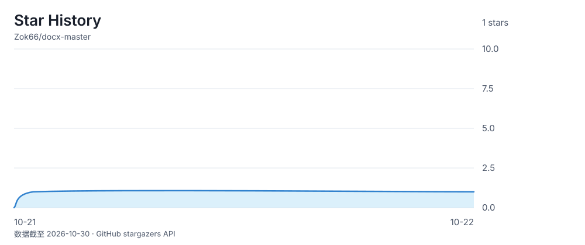

# docx-master

<div align="center">

**简体中文** | [English](README_EN.md)

</div>

<div align="center">

**直接操作 OOXML 的 Word 文档技能**

打开 `.docx` 这个 zip、直接改里面的 XML、原样封回去 —— **生成 · 读取 · 编辑 · 校验**，主链路零依赖


[CHANGELOG](CHANGELOG.md) · [安全策略](SECURITY.md) · [pro 独有操作](references/pro-only-ops.md) · [回归测试](tests/README.md) · [贡献](CONTRIBUTING.md)

</div>

> 🤖 **下一个 AI / 开发者请先读 [SKILL.md](SKILL.md)**（主流程、硬规则、路由索引），不要先全库扫描。

**作者**：佐罗斯（[Zok66](https://github.com/Zok66)）

> ⚠️ **非商用声明 Non-Commercial Notice**：本技能仅供个人免费使用（学习 / 办公 / 论文 / 实训报告），
> **禁止**任何形式的商业售卖、转卖、收费提供服务、在电商平台（闲鱼 / 淘宝 / 拼多多等）倒卖，
> 以及改名换皮重新打包后冒充自有产品发布。二次开发公开发布须显著标注原作者。
> 完整条款见 [LICENSE](LICENSE)（PolyForm Noncommercial 1.0.0）。发现倒卖欢迎通过 [Issues](https://github.com/Zok66/docx-master/issues) 举报。
>
> ℹ️ GitHub / Gitee 的许可证标签不识别 PolyForm，仓库页显示 "Other / 未标注" 属正常现象，以 [LICENSE](LICENSE) 文件正文为准。

## 亮点

- **原文件永不被修改** —— 所有写命令产出新副本，写盘前自动双校验（Node schema + XSD/OPC）
- **生成 · 读取 · 编辑 · 校验全链路，零 npm 依赖** —— 主链路只用 Node 标准库 + Python lxml
- **规范化**：把"手打的 `一、`/`1.1`"换成真多级自动编号，按角色重塑整篇排版
- **论文 / 实训报告开箱即用**：目录域、页码、页眉页脚、脚注尾注、题注、交叉引用、引文书目
- **交付门**：声明式断言（失败 exit 1 **阻断交付**）+ 变更清单，专抓"格式合规但用户没要求"的缺陷
- **看不见的对象有专门守门**：悬空书签 / 坏引用在 Word 里只会印"错误！未定义书签"，XSD 看不见它——`inspect_bookmarks` + `refsResolve` 看得见
- **批量套打**：一份模板 × 一张 CSV → N 份成品（Word 邮件合并的替代品）
- **pipeline 一条命令跑完整条链路**，任一步失败立即中止，不留"跑了前半段"的半成品
- **AI 友好**：`SKILL.md` 主控入口 + 规则唯一来源契约，回归测试守住"规则不许凭空消失"

## 隐私与安全

- **文档全部在本地处理**，不上传到任何云转换服务
- **不执行文档内的宏 / OLE 载荷**；不联网（`doctor` 仅探测本地已装工具）
- 原文件保持原样：每个写盘命令都产出新文件
- 处理**不受信任来源**的 docx 时，建议在隔离环境运行（与打开陌生 Word 文档的常识一致）
- 漏洞报告走私密渠道，详见 [SECURITY.md](SECURITY.md)

不依赖 Microsoft Word，不依赖 LibreOffice，不依赖 npm 上的 `docx` 包。打开 `.docx` 这个 zip、
直接改里面的 XML，再原样封回去 —— 所以能做的事比"库能封装的 API"多得多：
段落级重排、多级自动编号、目录域、脚注尾注、页面边框、内容控件、批量套打；
pro 分支更进一步覆盖水印、形状、画布、智能图形、图表、OLE。

原文件永不被修改：每个写盘命令都产出新文件，且在写入前跑校验。

## 两个版本

同一个仓库、两个分支。**标准版面向日常办公、论文、实训报告**——够用且轻；**pro 版是全功能**，包含所有不常用的扩展对象。

| 能力 | 标准版（`main`，默认） | pro 版（`pro`） |
|---|:---:|:---:|
| 生成 / 编辑 / 规范化 / 模板导入 | ✅ | ✅ |
| 读取侦察（12 个 `inspect_*` + `find_text`） | ✅ | ✅ |
| 页数 / 分页 / 页码 / 目录 / 图表目录 / 索引 | ✅ | ✅ |
| 页眉页脚（含分节覆盖）/ 页面设置 / 页面边框 | ✅ | ✅ |
| 脚注尾注 / 题注 / 交叉引用 / 书签 | ✅ | ✅ |
| 插图（嵌入式图片、裁剪、影效、浮动环绕） | ✅ | ✅ |
| 批注 / 修订 / 接受修订 / 批量套打 / 交付门 | ✅ | ✅ |
| 封面页 / 首字下沉 / 内容控件 / 引文书目 | ✅ | ✅ |
| 水印 | — | ✅ |
| 形状 / 文本框 / 艺术字 / 画布 / 智能图形 | — | ✅ |
| 图表（内嵌工作簿）/ OLE 嵌入 | — | ✅ |
| 构建基块（自动图文集）/ 自定义 XML | — | ✅ |
| PRO 完整 XSD 架构集（全套 schema 校验） | 精简 | 全套 |

```bash
# 标准版（默认，克隆即得）
git clone https://github.com/Zok66/docx-master.git ~/.workbuddy/skills/docx-master

# pro 版（全功能）
cd ~/.workbuddy/skills/docx-master && git checkout pro

# 切回标准版
git checkout main
```

被剥离的 8 个 `extend` op 在**代码里仍在**（只是没注册进 `OPERATIONS`），调用会明确报错并提示可用的 16 项操作——不会静默降级。清单与历史实现见 [`references/pro-only-ops.md`](references/pro-only-ops.md)。

## 版本

- **当前版本：[v0.17.0](https://github.com/Zok66/docx-master/releases/tag/v0.17.0)**（2026-10-20，协议变更为非商用）。
- **协议**：[PolyForm Noncommercial 1.0.0](LICENSE) —— 个人免费，商业用途需授权。
- **升级**：技能目录内 `git pull` 覆盖安装；升级前建议跑一遍 `node tests/run.mjs` 确认环境契约完好。
- **本次下载**：以 [Releases](https://github.com/Zok66/docx-master/releases) 页 Latest 为准，每个版本附能力清单与验收记录。
- **历史版本**：[Releases](https://github.com/Zok66/docx-master/releases)。

本版（v0.17.0）与旧版对比：

| 以前发布的版本 | 本版主要变化 |
|---|---|
| v0.17.0 | **协议变更**：MIT → PolyForm Noncommercial 1.0.0（非商用）；README 新增「亮点」「隐私与安全」 |
| v0.16.0 | 版本拆分：标准版（`main`）/ pro 版（`pro`）；社区文件、Star History、中英双语 README |
| v0.15.0 / 第十三~十五轮 | run / 段落级格式扩展 31 字段 + 拼音注音（`w:ruby`）纳入引擎；WPS「插入」选项卡对齐（docPartObj 内容控件 + glossary 封面排版）；批注锚点丢失等三项缺陷修复 |
| v0.15.0-pro | 全功能版固化到 `pro` 分支：水印、形状、画布、智能图形、图表、OLE、构建基块、自定义 XML |
| 第十轮及更早 | 交付门误报 / XSD 漏网 / 静默失效修复、skill 结构重构、书签与交叉引用、`batch_fill` 批量套打 |

完整更新记录见 [`CHANGELOG.md`](CHANGELOG.md)。

## 文档索引

| 文档 | 内容 |
|---|---|
| [`SKILL.md`](SKILL.md) | 技能主入口 —— 主流程、硬规则、路由索引（AI 触发即读） |
| [`references/pro-only-ops.md`](references/pro-only-ops.md) | 标准版不含的 8 个操作清单 + 切到 pro 版的方法 |
| [`CHANGELOG.md`](CHANGELOG.md) | 完整更新记录（能力与行为变更，逐轮可检索） |
| [`CONTRIBUTING.md`](CONTRIBUTING.md) | 怎么贡献：开发流程、硬约束、缺陷报告格式 |
| [`CODE_OF_CONDUCT.md`](CODE_OF_CONDUCT.md) | 行为准则 |
| [`SECURITY.md`](SECURITY.md) | 安全策略：支持的版本、漏洞私密报告渠道、威胁模型 |
| [`tests/README.md`](tests/README.md) | 回归测试怎么跑、怎么加规则 / 用例 |
| [`LICENSE`](LICENSE) | PolyForm Noncommercial 1.0.0（非商用许可，含历史 MIT 授权说明） |
| [`THIRD-PARTY-NOTICES.md`](THIRD-PARTY-NOTICES.md) | 第三方组件声明（Temml / ECMA-376 XSD 的来源与授权） |
| [`Push-Sync.markdown`](Push-Sync.markdown) | GitHub ↔ Gitee 全量同步指南（分支 / Tag / Release / 许可证） |
| [`references/`](references/) | 领域参考：配置 schema、定位器契约、工具全表、编号格式、题注、公式 … |
| [`pro/`](pro/) | 可选 Python 工具链：批注、接受修订、渲染、XSD 校验 |

## 能力一览

| 动作 | 说明 |
|---|---|
| **生成** | 省略 `source` 即以内置空白模板脚手架一篇新文档；也可从现有模板导入样式与编号 |
| **规范化** | 按角色重塑整篇文档：段落分类 → 绑定命名样式 → 安装多级自动编号，把"手打的 `一、`/`1.1`"换成真编号 |
| **编辑** | 定位式外科手术：替换 / 插入 / 删除段落、表格单元格、嵌入图片，可选生成修订痕迹 |
| **扩展** | `extend` 补引擎"故意不写"的部分：目录 / 图表目录 / 索引域、分页分节、页码、命名书签、脚注尾注、页面边框与背景、插入图片、内容控件、封面页、引文书目。水印 / 形状 / 图表 / OLE / 智能图形 / 构建基块 / 自定义 XML 属 pro 版 |
| **书签 / 交叉引用** | 建命名书签（新建段落、已有段落、跨段区间三种入口）、`refTo` → REF 域交叉引用、`{ "link": "#名字" }` 页内跳转；并用 `inspect_bookmarks` + `refsResolve` 断言抓"引用指向不存在的书签"这类**看不见的缺陷** |
| **批量** | 一份模板 + 一张 CSV / JSON 数据表 → 每行一份成品（Word 邮件合并的替代品） |
| **编排** | `pipeline`：把「生成配置 → apply → extend → 校验 → 断言」声明成一条链路，**一条命令跑完**，任一步失败立即中止——不留"跑了前半段"的半成品。无子进程环境（沙盒）可 `--emit-script` 生成 `set -e` 脚本，`bash` 一次执行得到同样的中止语义 |
| **读取** | 结构侦察：样式定义与继承链、编号方案与消耗数、节与页面设置、主题、题注、表格、文档骨架、任意范围的段落全文与计算样式、逐 run 格式、书签与交叉引用 |
| **校验** | 三层：Node schema 检查 + XSD / OPC 包图检查（写盘前自动跑），外加 `doctor` 的环境能力探测 |
| **交付门** | `verify`：① 声明式断言（如"页脚不得出现书名"）失败即非零退出、**阻断交付**；② 变更清单（产出 vs 基线）逐项列出本次引入的改动，供对着用户原话核对 |
| **批注 / 修订** | 添加批注（含回复）、接受全部修订生成干净副本 |
| **转换** | 旧版二进制 `.doc` → `.docx`（需 LibreOffice），渲染成图做视觉复核 |

## 安装

作为技能放进你的 skills 目录即可（WorkBuddy / Claude Code 等支持 `SKILL.md` 的环境）：

```bash
git clone https://github.com/Zok66/docx-master.git ~/.workbuddy/skills/docx-master
```

## 快速开始

```bash
SK=~/.workbuddy/skills/docx-master

# 0) 开工前：探测环境能力（哪些可选项真的可用、哪些会降级）
node $SK/scripts/doctor.js

# 1) 先侦察：结构、样式、编号、骨架
node $SK/scripts/overview.js 我的文档.docx
node $SK/scripts/inspect_bookmarks.js 我的文档.docx   # 书签 + 所有引用 + 悬空引用（有问题则 exit 1）

# 2) 单步设计：一份 config，先干跑不落盘，再落盘（输出新文件，原文件不动）
node $SK/scripts/apply.js --dry-run my.config.json
node $SK/scripts/apply.js my.config.json
python $SK/scripts/extend/extend.py extend.config.json   # 目录 / 水印 / 脚注 / 图表 …

# 3) 或者：把上面几步声明成一条链路，一条命令跑完（推荐）
node $SK/scripts/pipeline.js build.json          # 任一步失败即中止，末尾自动双校验
node $SK/scripts/pipeline.js build.json --plan   # 只看将要执行什么，不落盘

# 4) 交付门：断言 + 变更清单
node $SK/scripts/verify.js verify.json                     # 断言失败 → exit 1，交付阻断
node $SK/scripts/verify.js out.docx --diff 源文档.docx      # 列出本次改了什么，逐条核对
```

断言长这样（`verify.json`）——它是用机器表达的"用户要求"：

```json
{
  "file": "out.docx",
  "baseline": "源文档.docx",
  "assert": [
    { "type": "sectionCount", "eq": 3 },
    { "type": "hasField", "field": "TOC", "scope": "body" },
    { "type": "headerText", "regex": "佐罗斯" },
    { "type": "notContains", "text": "我的书名", "scope": "footer" },
    { "type": "footerText", "regex": "^\\s*第\\s*<PAGE>\\s*页\\s*\\/\\s*共\\s*<NUMPAGES>\\s*页\\s*$" },
    { "type": "refsResolve" },
    { "type": "bookmarkProblems" }
  ]
}
```

中间两条正是为了抓「页脚混进书名」这类**格式完全合规、但用户没要求**的改动——任何 schema 校验器都看不见它。最后两条同理：一个指向不存在书签的 REF / 跳转链接，在 Word 里只会渲染成"错误！未定义书签。"，而 XML 完全合规。

批量套打：

```bash
node $SK/scripts/batch_fill.js 合同模板.docx 客户.csv \
  --out-dir out/ --name "{{编号}}-{{客户名称}}.docx" --validate
```

## 设计原则

- **原文件永不被修改。** 每个写盘命令产出新副本，原文件保持原样。
- **稀疏声明。** 只声明坏掉的、缺失的、或用户明确要改的部分；没碰的样式 / 编号 / 段落原样保留。
- **先校验再交付。** 两个校验器检查不同层（Node schema 层 vs XSD + OPC 包图层），都要过。
- **多步链路必须由机器串起来。** 靠人记着"改完内容源要重跑配置生成"是最容易翻车的地方：源头没重跑，写入器会拿着**上一版配置**写出文件，而后面每一道校验都报 PASS。链路声明一次，跑一次。
- **"格式合规"不等于"可以交付"。** 用户没要求的改动（页脚多一行书名、多加一行署名）是合规的 XML，也是缺陷。断言管机械那一半，读变更清单管剩下那一半。
- **看不见的对象要专门查。** 书签没有渲染、没有样式、不加字数：丢一个，文件照样打开、照样通过 XSD，只有 Word 在某句话中间印出"错误！未定义书签。"。`inspect_bookmarks`（人工查看）与 `refsResolve`（机器守门）是唯一会去看它的两处。
- **内容与结构分离。** 标题 / 列表 / 题注这类"结构信号"由样式、编号、SEQ 域渲染，不写死在文本里。
- **主控只放规则，细节按需加载。** `SKILL.md` 每次触发都会全量进入上下文，所以它只承载"必须当场知道"的东西：主流程、硬规则、路由索引。长表与语义细节住在 `references/`，用到才读。一条规则只在**一处**定义，别处只做指向 —— `tests/run.mjs` 用契约清单守住这条线：规则可以换个文件放，但不能凭空消失。

## 目录结构

```
docx-master/
├── SKILL.md              # 技能主入口 —— 主流程 / 硬规则 / 路由索引（细节按需读 references/）
├── CHANGELOG.md          # 能力与行为变更（新增 / 修复 / 边界）
├── README.md             # 本文件
├── scripts/              # 主链路：零依赖 Node + Python lxml
│   ├── apply.js          # 统一写入器（样式 / 编号 / 主题 / 模板 / 编辑）
│   ├── batch_fill.js     # 模板 × 数据表 → N 份文档
│   ├── pipeline.js       # 单入口编排：一条命令跑完整条链路，失败即停
│   ├── verify.js         # 交付门：声明式断言 + 变更清单（零依赖直读 OPC）
│   ├── inspect_bookmarks.js  # 书签 / 引用 / 悬空引用侦察（有问题 exit 1）
│   ├── doctor.js         # 环境能力探测（子进程 / Python / 渲染工具链）
│   ├── merge_runs.js     # 合并碎片化 run（外部文档编辑前预处理）
│   ├── validate.js       # schema 校验
│   ├── overview.js       # 与 12 个 inspect_* 侦察工具
│   ├── _shared/          # 共享模块：OPC 读取、书签分析、定位器、校验器 …
│   └── extend/           # 扩展写入器（TOC / 书签 / 脚注 / 水印 / 图形 / 图表 / OLE …）
├── references/           # 领域参考：配置 schema、定位器契约、工具全表、编号格式、题注、公式 …
├── tests/                # 回归测试：结构 / 规则 / 资源 / 链接 四类契约 + smoke case
└── pro/                  # 可选的 Python 工具链（批注、接受修订、渲染、XSD 校验）
```

`standard` 与 `pro` 两版共用同一套代码，差异只有 `scripts/extend/extend.py` 的
`OPERATIONS` 注册表（16 vs 24 项）。本节描述的是**标准版**（`main` 分支）的目录。

## 回归测试

零依赖，一条命令：

```bash
node tests/run.mjs            # 结构 + 规则 + 资源 + 链接 四类契约
node tests/run.mjs --quiet    # 只打印失败项
node tests/run.mjs --smoke    # 额外跑 tests/cases/*.json
```

它回答四个问题：`SKILL.md` 的 frontmatter 与体积是否合规、**契约清单里每条「不许删的硬规则」是否还在**、声明的 references / scripts 是否都存在、所有文档链接（含锚点）是否可解析。改动 skill 之后跑一遍即可。

加规则、加用例的做法见 [`tests/README.md`](tests/README.md)。

## 依赖

| 部分 | 依赖 |
|---|---|
| 主链路（`scripts/`） | Node（无第三方包）+ Python + `lxml` |
| 扩展写入器（`scripts/extend/`） | Python + `lxml` |
| 校验（`scripts/validate.js`） | Node，零依赖 |
| 校验（`pro/scripts/validate.py`） | Python + `lxml` + `defusedxml` |
| 可选能力：渲染成图 / `.doc` 转换 / 接受修订 | LibreOffice（`soffice`）+ Poppler（`pdftoppm`） |

## 适用边界

**不做**：PDF、表格（xlsx）、纯文本 / Markdown 源文件（除非任务就是**输出** docx）。

**明确不在范围内**：布局表格的**结构重排**（单元格内的段落仍可编辑）、目录的**正文内容**（域会生成，但需在 Word 里更新域才算出结果）、页码交叉引用、域代码内部编辑。

**已支持**：页眉 / 页脚（含分节覆盖）、页面设置、脚注 / 尾注、批注、修订痕迹。

## 许可

**[PolyForm Noncommercial 1.0.0](LICENSE)** —— 非商用许可，完整条款见 [`LICENSE`](LICENSE)。

| 允许 | 禁止 |
|---|---|
| ✅ 个人免费使用（学习 / 办公 / 论文 / 实训报告） | ❌ 任何商业用途、销售、收费服务 |
| ✅ 复制、传播（须随附本协议与署名） | ❌ 电商平台倒卖（闲鱼 / 淘宝 / 拼多多等） |
| ✅ 修改、二次开发（须显著标注原作者） | ❌ 改名换皮后冒充自有产品发布 |
| ✅ 用于教学、研究、非营利组织内部使用 | ❌ 未标注原作者的二次分发 |

**历史授权说明**：v0.16.0 及更早版本曾以 MIT 授权发布（commit `291b86a` 之前），
依 MIT 条款已获得的授权持续有效，不受本次协议变更影响。

**内置第三方组件**遵循各自许可证，见 [`THIRD-PARTY-NOTICES.md`](THIRD-PARTY-NOTICES.md)。

## Star History

<picture>
  <source media="(prefers-color-scheme: dark)" srcset="assets/star-history-dark.svg">
  
</picture>

由 [`tools/gen-star-history.py`](tools/gen-star-history.py) 每 12 小时拉取 GitHub 星标时间并更新
（[workflow](.github/workflows/star-history.yml)）。浅色、深色 SVG 保存在本仓库；
曲线按当前保留的星标汇总。
